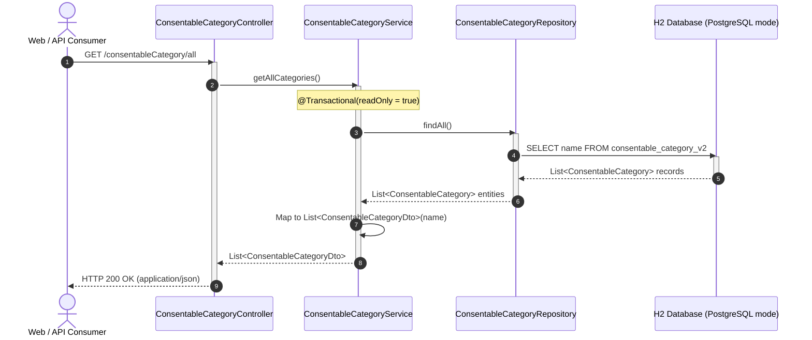

# REST API Documentation

This document describes the external REST APIs exposed by the **Consent Management Application**, including request/response contracts, sequence flows, and Swagger/OpenAPI integration.

---

## 1. Endpoints Overview

| Method | Path | Status | Description |
|---|---|---|---|
| `GET` | `/consentableCategory/all` | **Active / Tested** | Retrieves all existing `ConsentableCategory` records. |
| `GET` | `/swagger-ui.html` | **Active** | Interactive Swagger UI documentation. |
| `GET` | `/v3/api-docs` | **Active** | OpenAPI 3.0 JSON specification. |
| `GET` | `/h2-console` | **Active (Dev)** | Web interface for database queries and inspection. |

---

## 2. API Specifications

### `GET /consentableCategory/all`

Retrieves all configured consentable categories stored in the system.

- **URL**: `/consentableCategory/all`
- **Method**: `GET`
- **Authentication**: None (current phase)
- **Headers**:
  - `Accept: application/json`

#### Query Parameters
*None.*

#### Request Body
*None.*

#### Response Contract

- **Success Code**: `200 OK`
- **Content-Type**: `application/json`
- **Response Structure**: Array of JSON objects, each containing the `name` field.

```json
[
  {
    "name": "GTC"
  },
  {
    "name": "RU-NATV"
  },
  {
    "name": "KYC"
  },
  {
    "name": "KYC Test"
  }
]
```

#### Empty State
When no category records are present in the database, the endpoint returns an HTTP `200 OK` with an empty JSON array:
```json
[]
```

---

## 3. End-to-End Request Sequence



---

## 4. Live Verification Examples

### Curl Command
```bash
curl -i http://localhost:8080/consentableCategory/all
```

### Response Headers & Body
```http
HTTP/1.1 200 
Content-Type: application/json
Transfer-Encoding: chunked
Date: Sun, 18 Oct 2026 10:43:13 GMT

[]
```

---

## 5. Future Roadmap Endpoints

The persistence entities implemented in the foundation support the following upcoming REST interfaces:

1. `GET /consentableItem/byCategory/{categoryName}` - List consentable items by category.
2. `GET /targetCustomer/{customerId}/ratings` - List active consent ratings and cascade dependency flags for a customer.
3. `POST /consent/decision` - Record an `ACCEPTED` or `REFUSED` consent transaction with account-role authorizations.
4. `GET /consent/cascade/preview` - Preview downstream cascade effects prior to consent submission.
