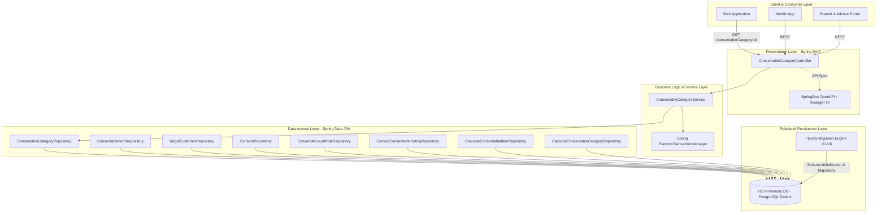

# System Architecture & Technical Design

This document details the architectural principles, component structure, technology stack, and design patterns utilized in the **Consent Management Application**.

---

## 1. High-Level Architecture Diagram



---

## 2. Layered Architecture

The application adopts a clean, layered architectural style with clear separation of concerns:

```
┌────────────────────────────────────────────────────────┐
│                   Presentation Layer                   │
│   Controllers, DTOs, Serialization, API Routing        │
└───────────────────────────┬────────────────────────────┘
                            │
┌───────────────────────────▼────────────────────────────┐
│                      Service Layer                     │
│   Transactional Boundaries, Business Rules, Mappers    │
└───────────────────────────┬────────────────────────────┘
                            │
┌───────────────────────────▼────────────────────────────┐
│                    Persistence Layer                   │
│   Spring Data JPA Repositories, Entity Mappings, Keys  │
└───────────────────────────┬────────────────────────────┘
                            │
┌───────────────────────────▼────────────────────────────┐
│                     Database Layer                     │
│   Flyway Migrations, SQL Constraints, Foreign Keys     │
└────────────────────────────────────────────────────────┘
```

### Layer Responsibilities

1. **Presentation Layer (`com.consentmanagement.controller`, `dto`)**:
   - Handles HTTP routing, parameters, status codes, and JSON serialization.
   - Converts internal domain models to external DTOs ([`ConsentableCategoryDto`](file:///Users/mohamedashfaq/Technical/Vibe%20Coding%20Projects/Consent%20Management%20Application/src/main/kotlin/com/consentmanagement/dto/ConsentableCategoryDto.kt)) preventing entity leaks across API boundaries.
   - Documented via OpenAPI 3 / Swagger (`/swagger-ui.html`, `/v3/api-docs`).

2. **Service Layer (`com.consentmanagement.service`)**:
   - Encapsulates transactional boundaries (`@Transactional(readOnly = true)`).
   - Coordinates multi-repository interactions and business validations.

3. **Persistence Layer (`com.consentmanagement.repository`, `entity`)**:
   - Utilizes Spring Data JPA interfaces for CRUD and derived query operations.
   - Implements `@Embeddable` and `@EmbeddedId` for composite key identity without database leaks.
   - Maintains strict unidirectional associations to prevent memory bloat, N+1 loading, and accidental cascading side-effects.

4. **Database & Schema Layer (`src/main/resources/db/migration`)**:
   - Pure version-controlled SQL migrations managed by Flyway (`V1` to `V6`).
   - Hibernate schema validation (`ddl-auto: validate`) guarantees exact synchronization between JPA entity metadata and physical database columns.

---

## 3. Technology Stack

| Component | Technology | Version | Purpose |
|---|---|---|---|
| **Language** | Kotlin | 2.3.0 | Modern, expressive, null-safe JVM language |
| **Runtime** | Java (OpenJDK) | 21 (LTS) | Modern JVM runtime with virtual threads |
| **Core Framework** | Spring Boot | 4.1.1 | Application bootstrap, auto-configuration, dependency injection |
| **Web MVC** | Spring MVC | 7.0.9 | Servlet-based REST controller engine |
| **ORM / JPA** | Hibernate ORM | 7.4.5.Final | Object-Relational Mapping & validation |
| **Database** | H2 Database | 2.4.240 | In-Memory DB running in PostgreSQL compatibility mode |
| **Schema Migrations** | Flyway Core | 10.x / Boot 4 | Strict database versioning and DDL execution |
| **API Documentation** | SpringDoc OpenAPI | 3.1.1 | Automated Swagger UI and OpenAPI 3.0 generation |
| **JSON Serialization** | Jackson + Kotlin Module | 2.18.x | High-speed JSON serialization for Kotlin data classes |
| **Build Tool** | Gradle Wrapper | 8.x (Kotlin DSL) | Deterministic build and test automation |
| **Testing** | JUnit 5, Mockito, MockMvc | - | Unit, slice, and integration test execution |

---

## 4. Key Architectural Decisions (ADRs)

### ADR-01: Explicit Foreign Key and Unidirectional JPA Associations
- **Context**: In domain models with rich graph relationships, bidirectional collections (`@OneToMany` on parent) frequently trigger accidental lazy-loading loops, heavy memory consumption, and cascading deletion bugs.
- **Decision**: Keep associations strictly unidirectional from child to parent (`@ManyToOne(fetch = FetchType.LAZY)`). Parent entities do not manage child collections. Queries from parent to child are executed via indexed repository methods (e.g., `findByCategory(category)`).
- **Consequences**: Zero accidental cascade deletes; highly predictable query performance; simple unit and slice testing.

### ADR-02: Composite Keys via `@Embeddable` and `@MapsId`
- **Context**: The `ContactConsentableRating`, `CascadeConsentableItem`, and `CascadeConsentableCategory` entities rely on natural composite keys.
- **Decision**: Use dedicated `@Embeddable` data classes (`CustomerConsentableRatingKey`, `CascadeConsentableItemKey`, `CascadeConsentableCategoryKey`) paired with `@EmbeddedId` and `@MapsId`.
- **Consequences**: Direct access to foreign key values without loading associated entity instances, while preserving full JPA relationship navigation.

### ADR-03: Strict Schema Management Strategy (Flyway + `ddl-auto: validate`)
- **Context**: Relying on Hibernate `ddl-auto: update` or `create-drop` leads to schema drift and unpredictable production deployments.
- **Decision**: Flyway migrations (`V1__...` through `V6__...`) are the single source of truth for DDL. Hibernate is set to `ddl-auto: validate` so any entity/schema discrepancy fails the build immediately.
- **Consequences**: 100% deterministic database schemas across local testing, CI/CD, and production environments.

### ADR-04: UUID Primary Keys for Scalability
- **Context**: Distributed microservice architectures and data-replication pipelines encounter sequence contention and predictable key vulnerabilities with auto-increment integers.
- **Decision**: All primary operational entities (`ConsentableItem`, `TargetCustomer`, `Consent`, `ConsentAccountRole`) use UUID v4 primary keys.
- **Consequences**: Safe offline ID generation, zero database lock contention during batch inserts, secure external API references.
