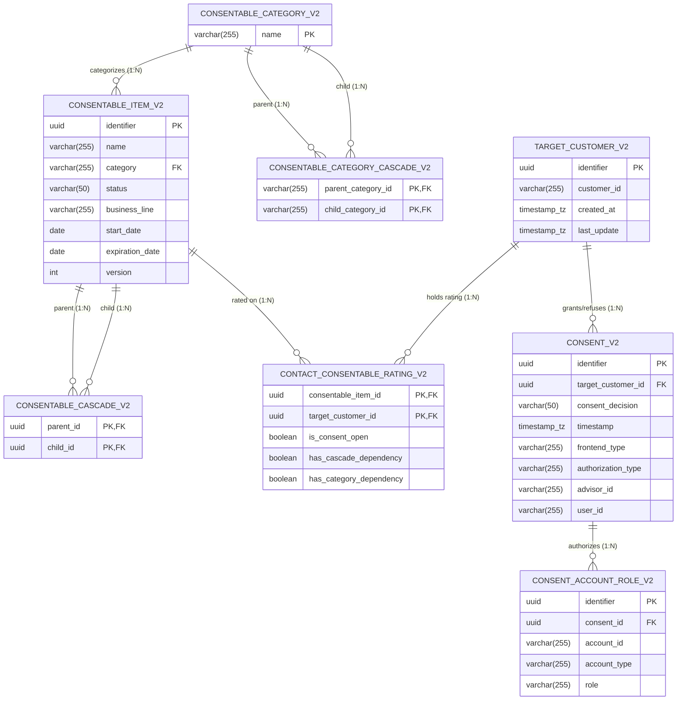

# Data Model & Relational Schema

This document details the relational database schema, Entity-Relationship (ER) design, composite keys, and foreign key constraints in the **Consent Management Application**.

---

## 1. Complete Entity-Relationship (ER) Diagram

---

## 2. Table Specifications & Mappings

### 2.1 Table: `consentable_category_v2`
- **Migration**: `V1__create_consentable_category_v2.sql`
- **Kotlin Entity**: [`ConsentableCategory`](file:///Users/mohamedashfaq/Technical/Vibe%20Coding%20Projects/Consent%20Management%20Application/src/main/kotlin/com/consentmanagement/entity/ConsentableCategory.kt)
- **Description**: Stores categories of consent policies and agreements.

| Column | SQL Type | Kotlin Type | Constraints | Description |
|---|---|---|---|---|
| `name` | `VARCHAR(255)` | `String` | `PRIMARY KEY` | Category unique name (e.g. `GTC`, `KYC`, `RU-NATV`) |

---

### 2.2 Table: `consentable_item_v2`
- **Migration**: `V2__create_consentable_item_v2.sql`
- **Kotlin Entity**: [`ConsentableItem`](file:///Users/mohamedashfaq/Technical/Vibe%20Coding%20Projects/Consent%20Management%20Application/src/main/kotlin/com/consentmanagement/entity/ConsentableItem.kt)
- **Description**: Individual agreements or consent policies subject to customer consent.

| Column | SQL Type | Kotlin Type | Constraints | Description |
|---|---|---|---|---|
| `identifier` | `UUID` | `UUID` | `PRIMARY KEY` | Unique item identifier |
| `name` | `VARCHAR(255)` | `String` | `NOT NULL` | Descriptive name of the consentable item |
| `category` | `VARCHAR(255)` | `ConsentableCategory` | `NOT NULL, FK` | References `consentable_category_v2(name)` |
| `status` | `VARCHAR(50)` | `String` | `NOT NULL` | Status code (e.g., `ACTIVE`, `DRAFT`, `INACTIVE`) |
| `business_line` | `VARCHAR(255)` | `String?` | `NULLABLE` | Business segment (e.g., `RETAIL`, `WEALTH`, `DIGITAL`) |
| `start_date` | `DATE` | `LocalDate?` | `NULLABLE` | Date the policy becomes effective |
| `expiration_date` | `DATE` | `LocalDate?` | `NULLABLE` | Date the policy expires |
| `version` | `INT` | `Int?` | `NULLABLE` | Version sequence number of the item |

---

### 2.3 Table: `target_customer_v2`
- **Migration**: `V3__create_target_customer_v2.sql`
- **Kotlin Entity**: [`TargetCustomer`](file:///Users/mohamedashfaq/Technical/Vibe%20Coding%20Projects/Consent%20Management%20Application/src/main/kotlin/com/consentmanagement/entity/TargetCustomer.kt)
- **Description**: Represents the customer subject to consent management.

| Column | SQL Type | Kotlin Type | Constraints | Description |
|---|---|---|---|---|
| `identifier` | `UUID` | `UUID` | `PRIMARY KEY` | System-internal customer identity |
| `customer_id` | `VARCHAR(255)` | `String` | `NOT NULL` | External customer code (e.g., `CUST-98765`) |
| `created_at` | `TIMESTAMP WITH TIME ZONE` | `Instant` | `NOT NULL` | Customer onboarding / creation timestamp |
| `last_update` | `TIMESTAMP WITH TIME ZONE` | `Instant` | `NOT NULL` | Timestamp of last modification |

---

### 2.4 Table: `consent_v2`
- **Migration**: `V4__create_consent_v2.sql`
- **Kotlin Entity**: [`Consent`](file:///Users/mohamedashfaq/Technical/Vibe%20Coding%20Projects/Consent%20Management%20Application/src/main/kotlin/com/consentmanagement/entity/Consent.kt)
- **Description**: Audit record of a customer's consent action (acceptance or refusal).

| Column | SQL Type | Kotlin Type | Constraints | Description |
|---|---|---|---|---|
| `identifier` | `UUID` | `UUID` | `PRIMARY KEY` | Unique transaction identifier |
| `target_customer_id` | `UUID` | `TargetCustomer` | `NOT NULL, FK` | References `target_customer_v2(identifier)` |
| `consent_decision` | `VARCHAR(50)` | `ConsentDecision` | `NOT NULL` | Enum: `ACCEPTED` or `REFUSED` |
| `timestamp` | `TIMESTAMP WITH TIME ZONE` | `Instant` | `NOT NULL` | Timestamp when decision was recorded |
| `frontend_type` | `VARCHAR(255)` | `String` | `NOT NULL` | Channel/UI (e.g., `WEB`, `MOBILE`, `BRANCH`, `API`) |
| `authorization_type`| `VARCHAR(255)` | `String` | `NOT NULL` | Auth mechanism (e.g., `PASSWORD_SMS`, `BIOMETRIC`) |
| `advisor_id` | `VARCHAR(255)` | `String?` | `NULLABLE` | Advisor code if assisted in branch |
| `user_id` | `VARCHAR(255)` | `String?` | `NULLABLE` | Operator or authenticated user ID |

---

### 2.5 Table: `consent_account_role_v2`
- **Migration**: `V5__create_consent_account_role_v2.sql`
- **Kotlin Entity**: [`ConsentAccountRole`](file:///Users/mohamedashfaq/Technical/Vibe%20Coding%20Projects/Consent%20Management%20Application/src/main/kotlin/com/consentmanagement/entity/ConsentAccountRole.kt)
- **Description**: Financial accounts and roles covered by a specific consent transaction.

| Column | SQL Type | Kotlin Type | Constraints | Description |
|---|---|---|---|---|
| `identifier` | `UUID` | `UUID` | `PRIMARY KEY` | Unique account-role record ID |
| `consent_id` | `UUID` | `Consent` | `NOT NULL, FK` | References `consent_v2(identifier)` |
| `account_id` | `VARCHAR(255)` | `String` | `NOT NULL` | Account identifier (e.g., `ACC-12345`) |
| `account_type` | `VARCHAR(255)` | `String?` | `NULLABLE` | Account classification (e.g., `CHECKING`, `SAVINGS`) |
| `role` | `VARCHAR(255)` | `String` | `NOT NULL` | Role on account (e.g., `PRIMARY_OWNER`, `AUTHORIZED_SIGNER`) |

---

### 2.6 Table: `contact_consentable_rating_v2`
- **Migration**: `V6__create_contact_consentable_rating_and_cascades.sql`
- **Kotlin Entity**: [`ContactConsentableRating`](file:///Users/mohamedashfaq/Technical/Vibe%20Coding%20Projects/Consent%20Management%20Application/src/main/kotlin/com/consentmanagement/entity/ContactConsentableRating.kt)
- **Composite Key**: [`CustomerConsentableRatingKey`](file:///Users/mohamedashfaq/Technical/Vibe%20Coding%20Projects/Consent%20Management%20Application/src/main/kotlin/com/consentmanagement/entity/ContactConsentableRating.kt) (`consentable_item_id`, `target_customer_id`)
- **Description**: Current consent readiness rating and dependency flags for a customer-item pair.

| Column | SQL Type | Kotlin Type | Constraints | Description |
|---|---|---|---|---|
| `consentable_item_id`| `UUID` | `UUID` | `PRIMARY KEY, FK` | References `consentable_item_v2(identifier)` |
| `target_customer_id` | `UUID` | `UUID` | `PRIMARY KEY, FK` | References `target_customer_v2(identifier)` |
| `is_consent_open` | `BOOLEAN` | `Boolean` | `NOT NULL` | `true` if consent is pending/open |
| `has_cascade_dependency` | `BOOLEAN` | `Boolean` | `NOT NULL, DEFAULT FALSE` | Flag indicating item-level cascade prerequisites |
| `has_category_dependency`| `BOOLEAN` | `Boolean` | `NOT NULL, DEFAULT FALSE` | Flag indicating category-level cascade prerequisites |

---

### 2.7 Table: `consentable_cascade_v2`
- **Migration**: `V6__create_contact_consentable_rating_and_cascades.sql`
- **Kotlin Entity**: [`CascadeConsentableItem`](file:///Users/mohamedashfaq/Technical/Vibe%20Coding%20Projects/Consent%20Management%20Application/src/main/kotlin/com/consentmanagement/entity/CascadeConsentableItem.kt)
- **Composite Key**: [`CascadeConsentableItemKey`](file:///Users/mohamedashfaq/Technical/Vibe%20Coding%20Projects/Consent%20Management%20Application/src/main/kotlin/com/consentmanagement/entity/CascadeConsentableItem.kt) (`parent_id`, `child_id`)
- **Description**: Defines item-to-item cascade dependency hierarchies.

| Column | SQL Type | Kotlin Type | Constraints | Description |
|---|---|---|---|---|
| `parent_id` | `UUID` | `UUID` | `PRIMARY KEY, FK` | Parent `ConsentableItem` (`identifier`) |
| `child_id` | `UUID` | `UUID` | `PRIMARY KEY, FK` | Dependent Child `ConsentableItem` (`identifier`) |

---

### 2.8 Table: `consentable_category_cascade_v2`
- **Migration**: `V6__create_contact_consentable_rating_and_cascades.sql`
- **Kotlin Entity**: [`CascadeConsentableCategory`](file:///Users/mohamedashfaq/Technical/Vibe%20Coding%20Projects/Consent%20Management%20Application/src/main/kotlin/com/consentmanagement/entity/CascadeConsentableCategory.kt)
- **Composite Key**: [`CascadeConsentableCategoryKey`](file:///Users/mohamedashfaq/Technical/Vibe%20Coding%20Projects/Consent%20Management%20Application/src/main/kotlin/com/consentmanagement/entity/CascadeConsentableCategory.kt) (`parent_category_id`, `child_category_id`)
- **Description**: Defines category-to-category cascade dependency hierarchies.

| Column | SQL Type | Kotlin Type | Constraints | Description |
|---|---|---|---|---|
| `parent_category_id` | `VARCHAR(255)` | `String` | `PRIMARY KEY, FK` | Parent `ConsentableCategory` (`name`) |
| `child_category_id` | `VARCHAR(255)` | `String` | `PRIMARY KEY, FK` | Dependent Child `ConsentableCategory` (`name`) |
