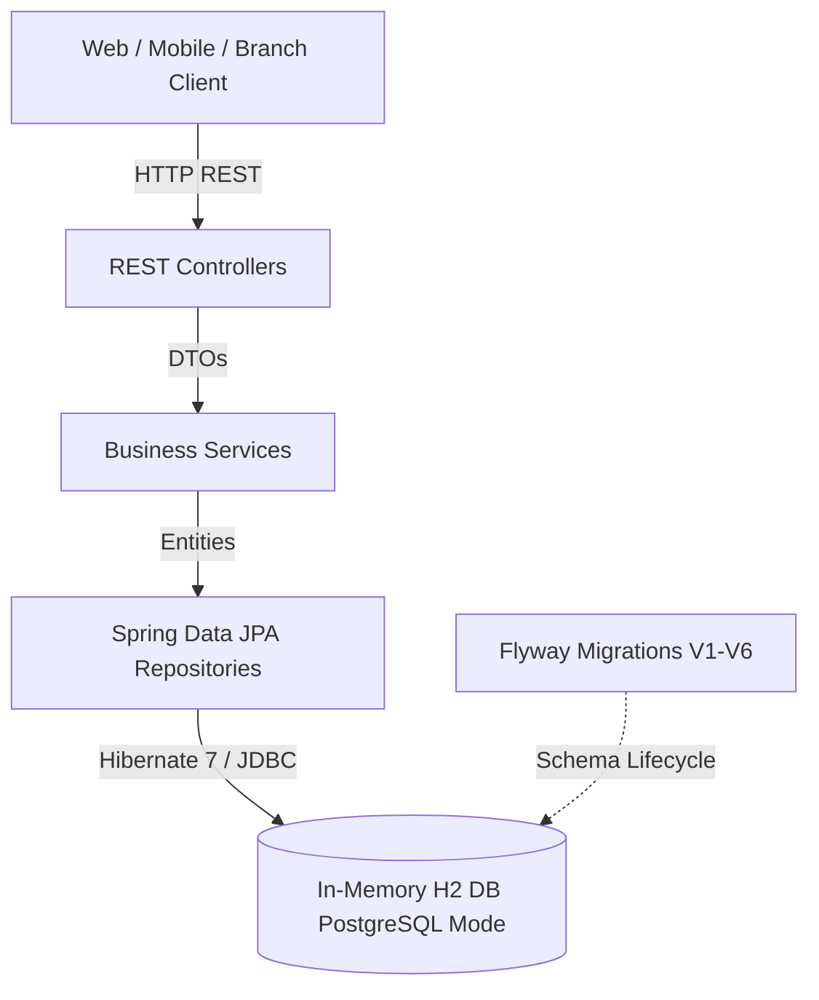

# Consent Management Application - Technical Documentation

Welcome to the technical documentation for the **Consent Management Application**. This repository implements a high-performance, enterprise-grade consent management system built on **Spring Boot 4.1.1**, **Kotlin 2.3.0**, **Hibernate 7**, and **Flyway**.

---

## Documentation Index

| Document | Description |
|---|---|
| [**Architecture & System Design**](./ARCHITECTURE.md) | High-level system architecture, layered design, technology stack, and architectural decisions. |
| [**Data Model & Relational Schema**](./DATA_MODEL.md) | Complete Entity-Relationship (ER) diagram, schema specifications, composite key models, and foreign key dependencies. |
| [**Implementation Details**](./IMPLEMENTATION_DETAILS.md) | Phased implementation log, test coverage breakdown, design patterns, and build/run instructions. |
| [**API Documentation**](./API_DOCUMENTATION.md) | REST API specifications, request/response formats, Swagger/OpenAPI details, and verification flows. |

---

## System Overview

---

## Core Domain Capabilities

1. **Category Management (`ConsentableCategory`)**: Categorizes consent agreements (e.g., `GTC`, `KYC`, `RU-NATV`).
2. **Item Management (`ConsentableItem`)**: Individual consent items with validity periods (`startDate`, `expirationDate`), status, and business line associations.
3. **Customer Representation (`TargetCustomer`)**: Unique customer identity and lifecycle timestamps.
4. **Consent Recording (`Consent` & `ConsentAccountRole`)**: Audit log of consent decisions (`ACCEPTED`, `REFUSED`), channel/frontend type, authorization method, and granular account-role mappings.
5. **Customer Consent Ratings (`ContactConsentableRating`)**: Composite key-indexed matrix of customer-to-item consent states and dependency flags.
6. **Cascade Dependency Graphs (`CascadeConsentableItem` & `CascadeConsentableCategory`)**: Direct parent-child dependency trees for automated cascade consent evaluation.
